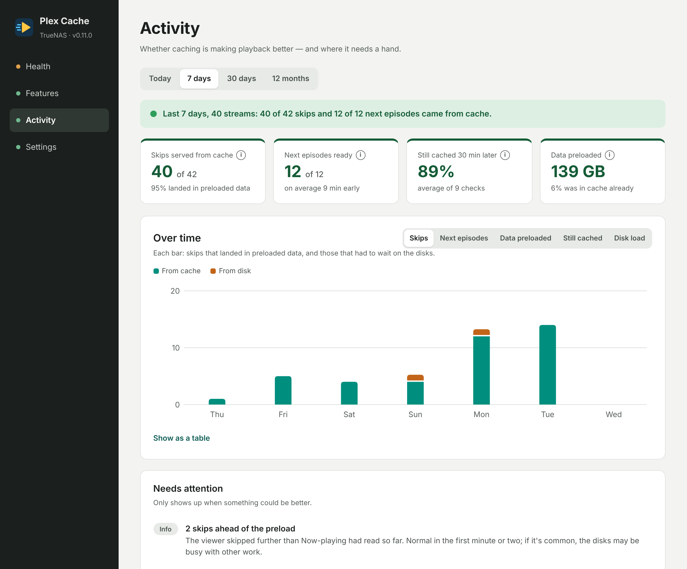
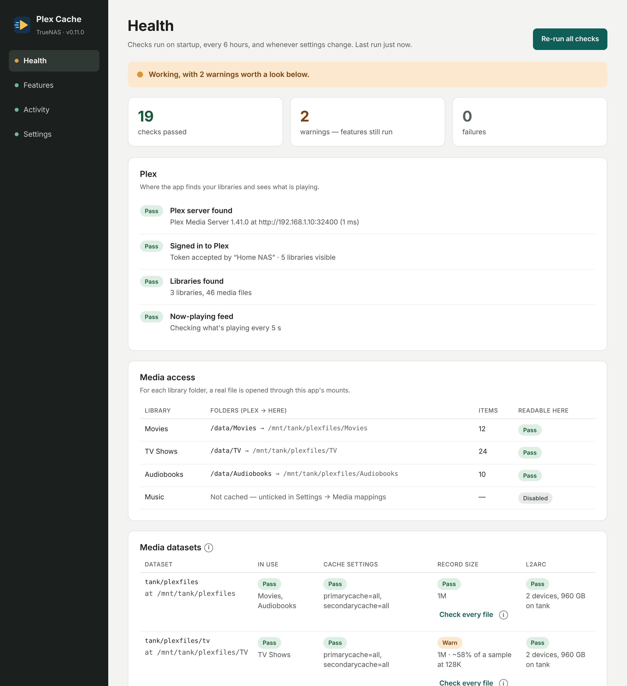
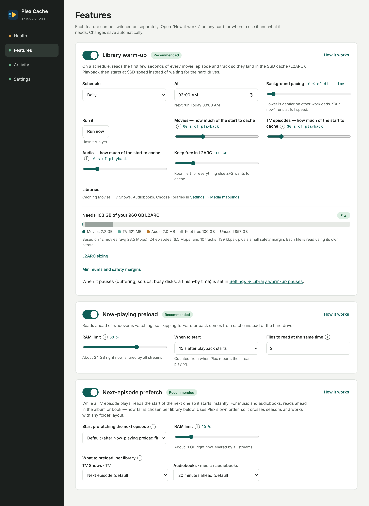
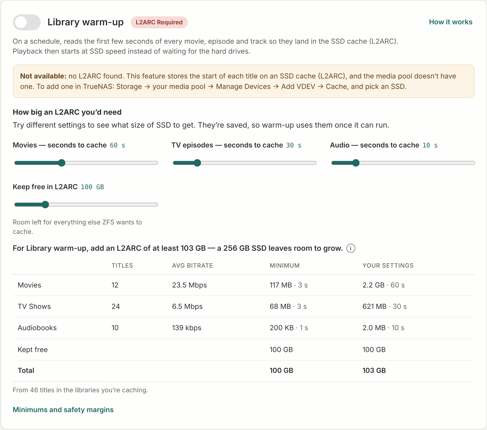
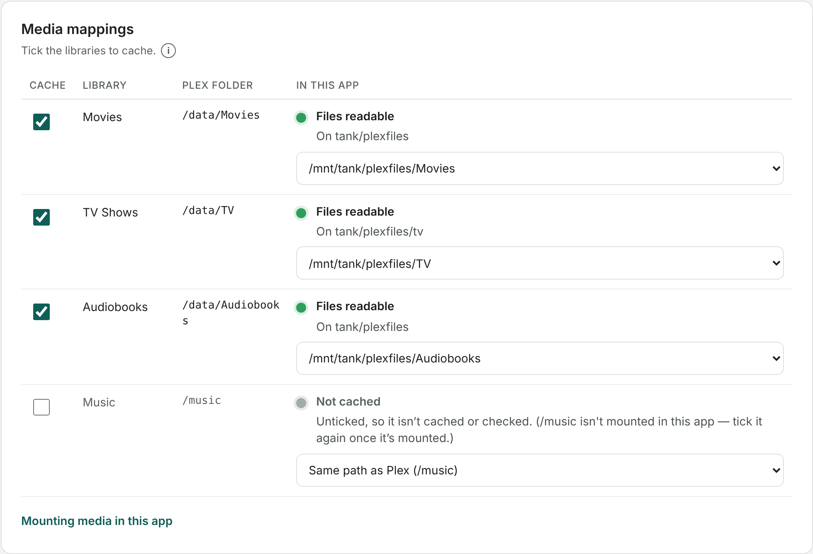
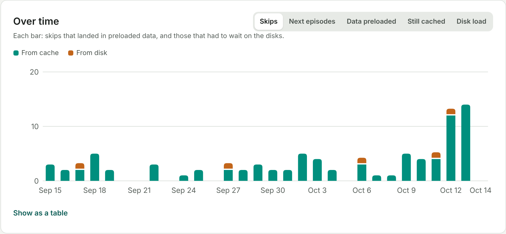
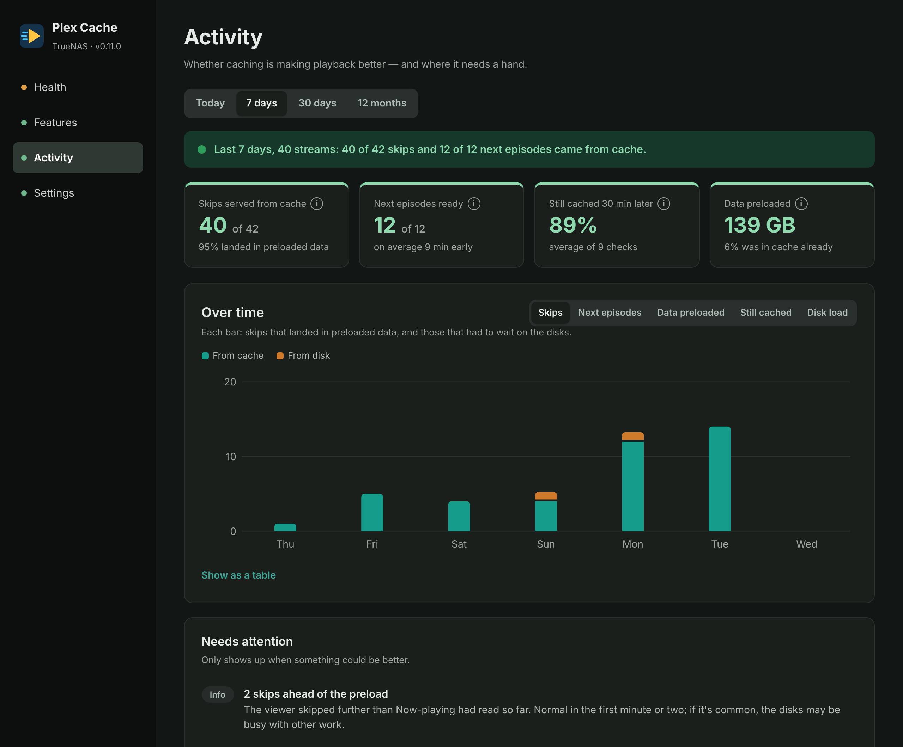
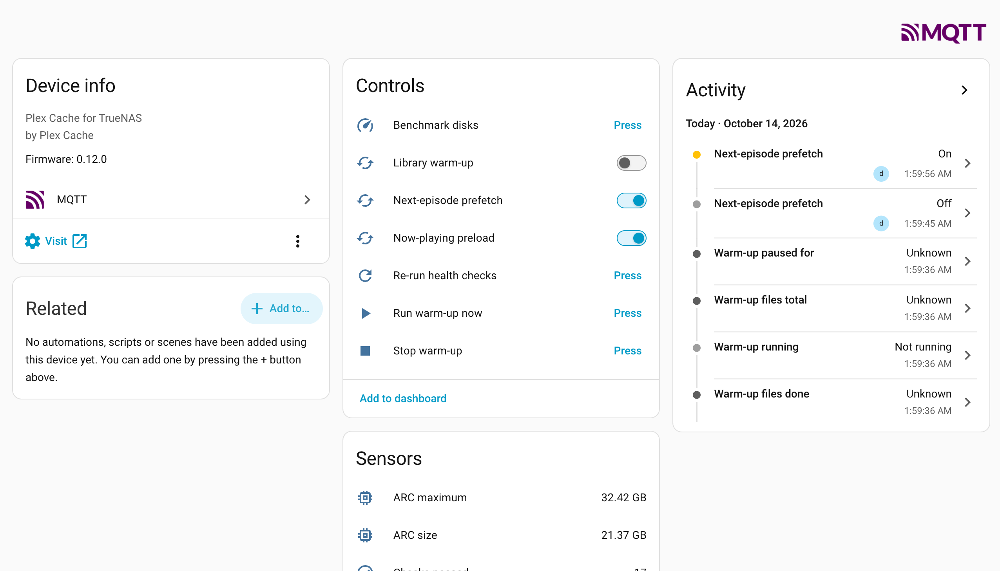

# Plex Cache for TrueNAS

**Superspeed your HDD-based Plex server.**

Plex Cache is a small app for TrueNAS that keeps the parts of your Plex library you're about to watch or listen to in ZFS's caches — RAM (ARC) and SSD (L2ARC) — so playback starts, seeks and moves on to the next episode or track at cache speed instead of waiting for hard drives.

Everything is set up in a web UI: what to cache, how much, and when. Health checks tell you whether your system is set up to benefit — with the exact command to fix anything that isn't — and the Activity page shows whether it's actually working.

<p align="center">
  
</p>

## Screenshots

| | |
|---|---|
| [](docs/screenshots/health.png)<br>**Health** — every check with a plain-English fix | [](docs/screenshots/features.png)<br>**Features** — three caching features, each with its own limits |
| [](docs/screenshots/l2arc-sizing.png)<br>**L2ARC sizing** — how big an SSD to buy, from your own library | [](docs/screenshots/media-mappings.png)<br>**Media mappings** — finds your library folders for you |
| [](docs/screenshots/activity-chart.png)<br>**Over time** — every measure by hour, day or month | [](docs/screenshots/activity-dark.png)<br>**Dark mode** — follows your system |

## Features

### Three ways to cache

- **Library warm-up** (needs an SSD cache, L2ARC) — on a schedule, reads the first seconds of every movie, episode and track so they sit on the SSD. Press play on anything and it starts at SSD speed.
  - Daily, weekly, every few hours, or manual — with "Run now".
  - Seconds to cache per type (movies, TV, audio), scaled by each file's own bitrate, so a 4K remux gets more bytes than a 720p episode.
  - Also caches each file's seek index (MKV Cues, MP4 `moov`), found from the file's own layout — players read it before they start.
  - Paced to a share of disk time, and steps aside — then carries on from the same file — while a player is buffering, while a preload is reading, during a scrub or resilver, when the disks are busy with other work, or after a finish-by time.
  - If your settings don't fit the SSD, seconds are reduced automatically.
- **Now-playing preload** — once a stream is playing and Plex's own buffer has had time to fill, reads the file into RAM from the play position onwards, then the beginning, so skips land in cache.
  - Start timing worked out from the file's bitrate and your disks' measured speed (direct play and transcoding buffer differently), or a fixed delay.
  - The whole file if it fits its RAM limit, otherwise as much as fits ahead of the viewer — and it starts again from the new spot after a big skip.
  - Reads a set number of files at a time, so hard drives aren't asked to seek between many streams at once.
- **Next-episode prefetch** — while an episode plays, reads the start of the next one in Plex's own order, across seasons and any folder layout.
  - For music and audiobooks, reads ahead in the album or book, chosen per library: 10, 20 or 60 minutes ahead, the rest of the album, the whole album (for shuffle), or everything by the artist (the rest of this album, the opening seconds of every other album, then the rest).
  - Any library can be set to "Don't preload".
- **RAM limits that respect your NAS** — Now-playing and Next-episode each get a share of the ZFS cache that's actually available (never more than its maximum), minus a reserve left for the rest of the NAS. Every read stays within them.

### Health checks that explain themselves

- **Plex and TrueNAS** — server reachable, signed in, API key accepted. The TrueNAS connection is read-only.
- **Media access** — opens a real file in every library folder, and suggests the right folder when the app has it mounted somewhere else.
- **Media datasets** — for every dataset a library is on: cache settings (`primarycache`, `secondarycache`), record size (1M for video; 512K or 1M for audio) and the SSD cache on its pool. Also flags datasets mounted in the app that no library uses, and works out which dataset really holds a library when datasets are mounted inside one another.
- **Record size, file by file** — a new record size only applies to files written afterwards, so Health samples the files themselves and says how many still use smaller blocks; "Check every file" counts them all. A built-in script rewrites them safely (see below).
- **ZFS and RAM** — how much RAM is free for preloading, and whether ZFS settings would stop warm-up from landing on the SSD (for example, warm-up reading faster than ZFS copies to the SSD).
- **Is it working?** — compares warm-up runs to show how much was already cached.
- Every problem comes with the fix — a setting to change or a command to copy — and features that can't work on your system are switched off with the reason, coming back on by themselves once it's fixed.

### Activity: is it actually helping?

- A report card for today, the last 7 days, 30 days or 12 months: skips served from cache, next episodes ready in time, how much preloaded data is still in RAM 30 minutes later, and how much was preloaded.
- An "Over time" chart for each measure (by hour, day or month, with a table view), and a "Needs attention" list that names the cause and the setting to change.
- RAM-limit use, how busy the disks were while people watched, what's playing and being cached now, warm-up runs and a live event log. History is kept for a year.

### Easy to set up and live with

- **Sign in with Plex** — no token hunting. Plex and TrueNAS addresses are filled in when they run on the same NAS.
- **L2ARC sizing** — tells you how big an SSD you'd need from your own library (titles × bitrate × seconds), and lets you try settings before you buy one.
- **Disk speed benchmark** per dataset, so cache hits and preload timing are judged against your actual disks.
- Help behind small ⓘ buttons instead of walls of text, a ↺ to put any setting back to its default, changes saved as you go, dark mode, and a layout that works on a phone.
- **MQTT, for Home Assistant and more** (optional) — publishes health, streams, RAM in use, ARC and L2ARC, warm-up progress, the Activity report and lifetime totals, and takes commands. In Home Assistant a "Plex Cache" device appears on its own with 60–80 entities, including switches, buttons and sliders; Node-RED, openHAB and other MQTT tools can use the same topics. Status lights show each step of the connection. See [MQTT](#mqtt-home-assistant-node-red-and-more).
- **Login** for the web UI — a username and password set in the app's YAML (on by default; the example password is refused).
- **Update notices** — checks GitHub every 6 hours (can be switched off in Settings) and says when there's a newer version, in the web UI and in Home Assistant.
- **Safe by design** — runs as TrueNAS's unprivileged `apps` user in a read-only container, with media mounted read-only and all extra permissions dropped; it writes only to its settings folder. Pure Python with no third-party dependencies. If its settings folder isn't writable it says how to fix it, rather than restarting endlessly.

## Install on TrueNAS

TrueNAS doesn't support third-party app catalogs since 24.10, so this installs as a custom app.

1. **Create a dataset for settings**, e.g. `tank/apps/plex-cache`, and give the `apps` user (568) read/write access.
2. **Find your Plex app's media mounts.** In Apps → Plex → Edit, note each *host path* and the *mount path* inside the container (for example `/mnt/tank/plexfiles` → `/data`).
3. **Apps → Discover Apps → ⋮ → Install via YAML**, name it `plex-cache`, and paste [`compose.yaml`](compose.yaml). Change the lines marked `CHANGE ME`:
   - the settings dataset → `/config`
   - each media host path → **the same mount path Plex uses**, read-only. Add a line per mount if Plex has several.
   - `PLEXCACHE_PASSWORD` (and the username, if you like) → your own; the example password is refused. See [the web UI login](#the-web-ui-login).
4. Open `http://<your-nas-ip>:8642` and sign in.
5. Open **Settings**. If Plex and TrueNAS run on the same NAS, their addresses are filled in for you; otherwise enter your NAS's IP (Plex's port 32400 is added automatically). Choose **Sign in with Plex** — Plex only shares library and playback details with apps that hold a token. Optionally add a TrueNAS API key (user menu → API Keys) so Health can see your cache devices and dataset settings. The app only reads from the API. Status lights on the page show what's working.
6. If a library shows as not found, either mount it at the same path Plex uses, or mount it anywhere and pick the folder under **Settings → Media mappings**. Folders that contain the library's files are marked ✓.
7. Check **Health** — it should say “Everything is OK” — then switch features on in **Features**.

### The web UI login

The web UI asks for a username and password, set under `environment:` in the app's YAML (Apps → plex-cache → Edit):

```yaml
      PLEXCACHE_USERNAME: plex-cache
      PLEXCACHE_PASSWORD: "something-long"
```

The example password in `compose.yaml` (`change-me`) is never accepted — anyone can read it here — so set your own when you install. Signing in with it explains what to change. The sign-in page's ⓘ button says where to find and change these settings.

To turn the login off, put a `#` in front of both lines (or remove them). The web UI then opens without a password, for anyone on your network.

The browser stays signed in for 30 days (a signed, HttpOnly cookie; the signing key lives in the config folder). **Sign out** ends that session on the server too, so a copied cookie stops working, and changing the password signs everyone out. Wrong passwords are answered one at a time, a second apart (guessing in parallel is no faster), and logged under Activity. Scripts can use HTTP Basic auth. `/healthz` stays open so TrueNAS can check the app is up.

## MQTT (Home Assistant, Node-RED and more)

Off until you switch it on in **Settings → MQTT**. MQTT is the common language of home-automation and monitoring tools: everything connects to a *broker*, which passes messages along. Plex Cache connects to your broker as a client.

The settings card shows a light for each step — broker found, TLS, login accepted, publishing — with the reason when one fails, and a **Reconnect now** button. Turn off **Allow control** for a watch-only connection. Broker ACLs can limit the app's login to the `plexcache/#` and `homeassistant/#` topics.

### MQTT – Home Assistant

<p align="center">
  <a href="docs/screenshots/home-assistant.png"></a>
</p>

With **Home Assistant discovery** on (the default), a **Plex Cache** device appears in Home Assistant by itself — nothing to add to `configuration.yaml`. Its **Visit** link opens the Plex Cache web UI.

1. Install the **Mosquitto broker** add-on and the **MQTT** integration.
2. Add a Home Assistant user just for this app (Settings → People → Users, e.g. `plexcache`). Mosquitto accepts any Home Assistant login.
3. In Plex Cache, tick **Publish over MQTT** and enter the broker address (your Home Assistant's IP), port `1883`, and that username and password.

For TLS, use port `8883` and tick **Use TLS**. The Mosquitto add-on only opens 8883 when it has certificate files (by default `fullchain.pem` and `privkey.pem` in Home Assistant's `/ssl` folder); otherwise its log says `SSL not enabled - No valid certs found!` and the port is closed. If the certificate is for a domain name (e.g. Let's Encrypt) and you connect by IP, leave **Verify** off — the connection is still encrypted.

What Home Assistant gets — a main **Plex Cache** device with three linked ones, so everything sits under a clear heading (each has its own page and dashboard card):

| Device | Sensors | Diagnostic |
| --- | --- | --- |
| **Plex Cache** | health (ok / warning / problem) and summary, *Problem*, streams playing, *Streaming*, what's being preloaded | checks passed / warnings / failures, last check, Plex and TrueNAS connected, health check / benchmark running, version, record size and cache settings per dataset |
| **Plex Cache Activity** | the Activity report for today, 7 or 30 days: verdict, streams, skips (and from cache), next episodes (and ready in time, how early), still cached 30 min later, data preloaded, disks busy, items needing attention; lifetime totals for long-term statistics | |
| **Plex Cache Library warm-up** | state (off / idle / preparing / running / paused), progress, why it's paused, next and last run, last result, already cached, L2ARC growth | files done / total, data read, files in the last run |
| **Plex Cache RAM & ZFS** | Now-playing and Next-episode RAM in use, ARC size and hit ratio, L2ARC filled | RAM limits, ZFS cache available, L2ARC size |

The main device also has the **controls** — switches for the three features; buttons to run or stop warm-up, re-run checks and benchmark disks; RAM limits, pacing and reserve; poll interval, next-episode start, and the preload choice for each TV, music and audiobook library — and an **update** entity that shows when a newer version is on GitHub, with a link to the project.

The **Visit** link uses the address and port your browser last used to open Plex Cache. Behind a reverse proxy, set `PLEXCACHE_URL` (e.g. `https://plexcache.example.com`) in the app's YAML instead.

### MQTT – other tools

Node-RED, openHAB, ioBroker, Telegraf and the like can use the topics directly (`plexcache` can be changed). Turn off **Home Assistant discovery** if you don't need it.

| Topic | |
| --- | --- |
| `plexcache/state` | everything, as one retained JSON message — sent every 30 s and straight away after a change |
| `plexcache/availability` | `online`, or `offline` (also sent by the broker if the app disappears) |
| `plexcache/update` | the installed and newest version, for Home Assistant's update entity |
| `plexcache/set/<name>` | commands, when **Allow control** is on: `warmup_enabled`, `nowplaying_enabled`, `nextepisode_enabled` (`ON`/`OFF`); `run_warmup`, `stop_warmup`, `recheck`, `benchmark` (any payload); `nowplaying_ram_percent`, `nextepisode_ram_percent`, `warmup_pacing_percent`, `ram_reserve_gb` (a whole number, in the same range as the web UI); `poll_seconds` (`3`, `5`, `10`, `30`); `start_at` (`default`, `after_nowplaying`, `80`, `90`); `library_<key>_preload` (`off`, `next`, `10`, `20`, `60`, `rest`, `album`, `artist`) |
| `homeassistant/…/config` | Home Assistant discovery (openHAB and Domoticz read it too) |

## How it works

Plex doesn't read a whole file at once — it buffers a little ahead of playback and reads more as needed. The disk delays you feel are seeks: starting a title, skipping, moving to the next episode. Plex Cache reads those parts *before* Plex asks for them, so ZFS already has them in RAM or on SSD.

- Bitrates come from Plex per file (or are calculated from size and duration when Plex has none), so a 4K remux gets more bytes cached than a 720p episode for the same number of seconds.
- Background work is paced (by default 10% of disk time) and pauses for anything more important (see Library warm-up above). "Run now" runs at full speed and ignores the busy-disks and finish-by pauses, but still steps aside for buffering, preloads and scrubs.
- **Disk speed** (Settings) is measured per dataset by *Benchmark now*, which times reads of a few media files on each one. A read counts as "already cached" when it runs at least 4× faster than its dataset's speed. Unreadable files are reported, never counted as hits.
- L2ARC fills gradually and is evicted over time, which is why warm-up runs on a schedule. Size your L2ARC larger than the estimate so cached data lasts longer — even a modest SSD helps.

## Requirements

- TrueNAS SCALE / Community Edition 24.10 or later (Docker-based apps)
- Plex Media Server reachable from the NAS
- `primarycache=all` on each media dataset for any feature to work there: ZFS only fills L2ARC from data that passed through RAM, so `primarycache=metadata` means nothing gets cached (the old scripts recommended that — it doesn't work)
- For Library warm-up: at least one cache (L2ARC) device on the media pool, and `secondarycache=all` on the media dataset
- `recordsize=1M` on datasets holding movies or TV; audio-only datasets can use `512K` or `1M`. A new record size only applies to files written afterwards, so Health also samples the files themselves and says when many were written with smaller blocks.

### Rewriting files after a record size change

`plexcache/tools/rewrite_blocks.py` copies files that were written with smaller blocks, one at a time, and swaps each one in place, so they pick up the dataset's current record size. Health shows the command with a download link to the script from the app itself. Run it in the TrueNAS shell (the app can't do it: media is mounted read-only):

```sh
sudo python3 rewrite_blocks.py tank/plexfiles            # look only
sudo python3 rewrite_blocks.py tank/plexfiles --apply    # rewrite
```

It paces itself (`--mb-per-sec`, default 80), skips files any program has open, copies with plain reads and writes so ZFS block cloning can't reuse the old blocks, checks each copy byte for byte, keeps owners, permissions, timestamps and ACLs, swaps with an atomic rename, leaves hard-linked files alone, and stops before free space runs low. It can be stopped and run again. Snapshots keep the old blocks until they expire, and replication will send rewritten files again.

## Development

To try changes on your own TrueNAS before pushing, see [`dev/README.md`](dev/README.md): a test copy of the app plus `tnsync`, which runs the tests, copies your code to the NAS and restarts the test app in one command.

```sh
python3 tests/run.py      # progress bar; tests use fake Plex, TrueNAS and MQTT servers
python3 dev/coverage.py   # the same, with test coverage per file (Python 3.12+)
python3 tests/demo.py     # UI demo at http://127.0.0.1:8642 with sample data
node dev/screenshots.js   # README screenshots (see the file for how to run it)
docker build -t plex-cache .
```

### Environment variables

| Variable | |
| --- | --- |
| `PLEXCACHE_USERNAME`, `PLEXCACHE_PASSWORD` | web UI login ([see above](#the-web-ui-login)) |
| `PLEXCACHE_URL` | the address links to the web UI should use (Home Assistant's **Visit**), when it's behind a reverse proxy |
| `PLEXCACHE_CONFIG` | settings folder (default `/config`) |
| `PLEXCACHE_PORT`, `PLEXCACHE_HOST` | where the web UI listens (default `8642` on all addresses) |
| `PLEXCACHE_DEBUG` | any value: more detail in the app's log |
| `PLEX_URL`, `PLEX_TOKEN`, `TRUENAS_URL`, `TRUENAS_API_KEY` | fill in those settings when they're empty (handy for scripted installs); the web UI can change them afterwards |
| `TZ` | time zone for schedules |

### The config folder

`settings.json` (all settings, including the Plex token, TrueNAS API key and MQTT password — readable only by the app), `history.json` (Activity history), `session.key` and `signed-out.json` (web UI sessions), and small files remembering the web UI's address, "Check every file" results and the Home Assistant entities published. `GET /api/export` downloads the settings without any secrets.
